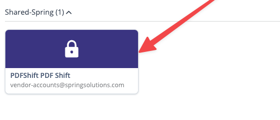
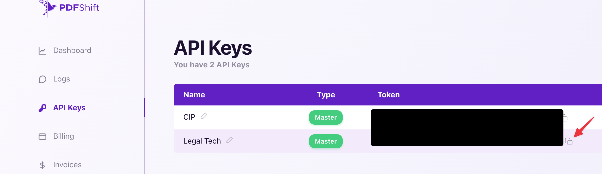
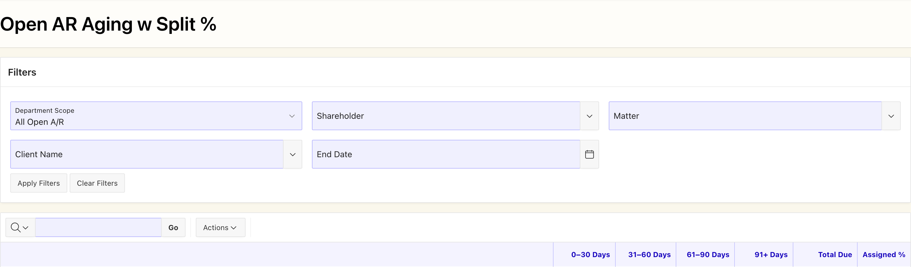
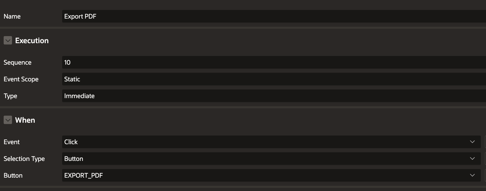
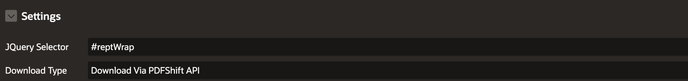
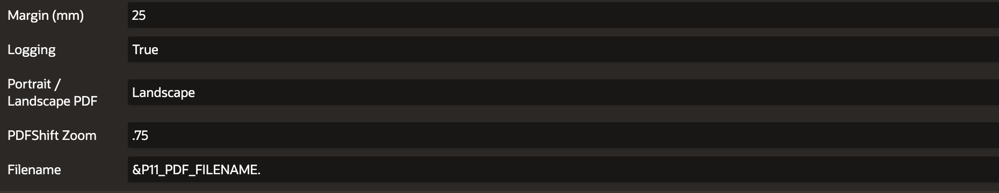

# HowTo: Focus PDF Export with Plugin (PDFScreenCapture)

Use the Spring APEX Screen Capture plugin with **PDFShift** to export Focus reports as PDF files. The PDF keeps the report formatting. This guide includes general setup and a complete [GB-19](https://springsolutions.atlassian.net/browse/GB-19) example.

PDFShift converts a copy of the report HTML and its styles. It does not read the database or load other report pages. Apply the filters and display all matching rows before export. Wait for the report refresh to finish.

## 1. Import the plugin

1. Open the [plugin export on GitHub](https://github.com/ktechgit/apex-plugin-apexscreencapture/blob/master/source/spring-apex-to-pdf-v2.2.sql). Select **Download raw file** to save the SQL file.
2. In the target APEX application, open **Shared Components → Plug-ins → Import** and import the SQL export.
3. Keep the installed plugin's source files synchronized with [`server/`](../../server/) and its renderer with [`source/source.sql`](../../source/source.sql).

Git contains the JavaScript source files, not the generated minified files. APEX generates minified files. The plugin loads source files in both debug and normal modes.

## 2. Check the API key only if PDF download fails

Most new schemas and Focus instances already include the API-key item and computation. **Do not create them again.** GB-19 did not need this setup.

First, configure the report and try a PDF download. If the download fails, check the error. If the error indicates a missing or invalid API key, check the settings below.

### Check the existing application item

Check for application item **`PDF_SHIFT_API_KEY`** and its computation after authentication. The parameter-store name is **`PDFSHIFT_API_KEY`**. These names are different.

If the setup is missing, create the item and computation. Set the computation type to **SQL Query (return single value)**:

```sql
select p_value
from system_parameters
where p_name = 'PDFSHIFT_API_KEY'
```

The query must return one nonempty value. Use an error message such as `Unable to retrieve PDFShift API key from system_parameters`.

### Get the key if it is missing or invalid

1. In LastPass, open **Shared-Spring → PDFShift PDF Shift**, using the **vendor-accounts@springsolutions.com** account.
2. Use that saved login to sign in to [PDFShift API Keys](https://app.pdfshift.io/env/apikeys).
3. Locate **Legal Tech** and use its copy-token control. Do not use the **CIP** key for this setup.
4. Save the copied token in the application's parameter store through the normal credential setup process.





## 3. Configure the report and Export PDF button

1. Wrap the report content in a nonvisual region if no suitable parent exists. Set its **Static ID** to `reptBody`, without the hash.
2. Create **Export PDF** in the top-right area above the filters/data grid. Set its action to **Defined by Dynamic Action**.
3. Create a click dynamic action on the button. Add a true action using **APEX Screen Capture (w/ PDFShift)** and disable **Fire on Initialization**.
4. Select the settings below. Wait for the report refresh to finish before capture.

| Setting | Configuration |
| --- | --- |
| JQuery Selector | `#reptBody`, or the actual wrapper Static ID prefixed with `#`. |
| Download Type | **PDFShift**. |
| Orientation | Portrait or landscape for the report. Wide reports may need landscape. |
| Margin / Zoom | Fit all columns and leave space for any footer; verify the resulting PDF. Avoid an empty/zero margin with the current request fallback. |
| File Name | A descriptive report filename without an extension. PDFShift mode adds `.pdf`. |

For an interactive report, the generated content container may be a better export target than the outer region. With region Static ID `reptBody`, that target is `#reptBody_content`. Use the actual `#<static_id>_content` present in the DOM; the `_content` suffix is not a separate Static ID to configure.

### Exclude controls, not report data

Add this to the **Custom Attributes** of buttons or child regions that should not appear in the PDF:

```html
data-html2canvas-ignore="true"
```

The plugin removes child elements with this attribute, even when its value is `"false"`. It does not remove the selected capture element. The plugin already excludes the interactive-report toolbar and controls. Add a filter summary to the PDF if readers need it.

## 4. Interactive Report Handling

APEX can put a sticky heading in a separate table. That structure can cause incorrect headings in the PDF. Prepare the report before export, then restore it after capture. The plugin does not do these steps automatically.

The generic example uses these Static IDs:

| Region | Static ID | Use |
| --- | --- | --- |
| Report wrapper | `reptWrap` | Contains the title and report. Set the plugin selector to `#reptWrap`. |
| Interactive report | `reptBody` | APEX creates `reptBody_content` inside this region. Use this ID for table preparation and CSS. |
| PDF title | `pdfTitle` | Optional title region inside the wrapper. Use **Blank with Attributes** for the title and wrapper. |

Replace these IDs with your report's IDs. Apply filters and display all matching rows before capture. Wait for the report refresh to finish.

### Action 1: prepare the report

Add **Execute JavaScript Code** before the plugin action:

```javascript
// Remove the on-screen sticky heading and its placeholder.
$('.js-stickyTableHeader').remove();
$('.js-stickyWidget-placeholder').remove();

const report = document.getElementById('reptBody_content');
const row = report.querySelector('th.a-IRR-header')?.closest('tr');

// A real table heading can repeat on later PDF pages.
if (row && row.parentElement.tagName !== 'THEAD') {
  const table = row.closest('table');
  const thead = table.tHead || table.createTHead();
  thead.appendChild(row);
}

report.querySelectorAll('table.a-IRR-table').forEach(table => {
  table.style.setProperty('margin-top', '0px', 'important');
});

// Omit this step if the wrapper has no PDF title region.
document.getElementById('pdfTitle').classList.add('pdf-export-visible');
```

This moves the existing heading row into `<thead>`. It does not add a second heading row. The zero margin removes the sticky-header offset.

The first two selectors affect the whole page. For a page with multiple interactive reports, inspect the sticky-heading locations and limit the cleanup to the target report.

### Page CSS: repeat headings and keep rows together

Add this to **CSS → Inline**:

```css
#reptBody_content thead {
  display: table-header-group;
  break-inside: avoid;
}

#reptBody_content thead tr {
  break-inside: avoid;
  break-after: avoid;
}

#reptBody_content tbody > tr {
  break-inside: avoid;
  page-break-inside: avoid;
}
```

Body-row protection fixed the heading overlap on GB-19 continuation pages. A zero-margin override alone did not fix it. Do not apply `break-inside: avoid` to the whole table or `<tbody>`. Long reports must span pages. A row taller than a page cannot stay together.

**Keep these rules outside `@media print`.** PDFShift uses screen styles unless the request sets `use_print: true`. The current plugin does not set that option.

### Page CSS: start each group on a new page

Add a class to each group heading in the report's HTML column. Do not add the class to totals:

```html
<span class="pdf-group-header">Group name</span>
```

Keep dynamic labels escaped in SQL. Turn off **Escape Special Characters** only for the column that renders this HTML.

```css
#reptBody_content tr:has(.pdf-group-header)
  ~ tr:has(.pdf-group-header) {
  break-before: page;
  page-break-before: always;
}
```

The first group stays on the first page. Each later group starts on a new page. Its remaining rows can continue onto later pages. The selector requires group heading rows with the same parent. Keep groups in order. CSS cannot select rows by their text.

### Page CSS: show the title only in the PDF

Put this HTML in the `pdfTitle` region. Replace the sample title and summary with your report's text or escaped page-item substitutions:

```html
<div class="rept-heading">
  <h1>Report title</h1>
  <p>Applied filter summary</p>
</div>
```

```css
#pdfTitle { display: none; }
#pdfTitle.pdf-export-visible { display: block; }

#pdfTitle .rept-heading { text-align: center; margin-bottom: 1rem; }
#pdfTitle h1 { margin: 0; font-size: 1.25rem; line-height: 1.3; }
#pdfTitle p { margin: .4rem 0 0; font-size: .85rem; line-height: 1.5; }

html:has(#pdfTitle.pdf-export-visible),
body:has(#pdfTitle.pdf-export-visible),
#reptWrap:has(#pdfTitle.pdf-export-visible),
#pdfTitle.pdf-export-visible {
  background: #fff !important;
  background-image: none !important;
}
```

The temporary class shows the title and gives the PDF a white background. It does not remove table-header shading. Normal page styles return when the cleanup action removes the class.

### Action 2: capture the wrapper

Use **APEX Screen Capture (w/ PDFShift)** with selector `#reptWrap`. See section 3 for the other settings. Add the optional page-number flag from section 5 to Action 1 if needed.

### Action 3: restore the report

Add **Execute JavaScript Code** after the plugin action:

```javascript
// Omit this step if the wrapper has no PDF title region.
document.getElementById('pdfTitle').classList.remove('pdf-export-visible');
apex.region('reptBody').refresh();
```

The plugin copies the prepared HTML before it sends the request. Cleanup does not change that copy. Refresh restores the normal sticky heading and scrolling behavior. Do not refresh between preparation and capture.

### Optional: remove a border through page-break space

Try this if a table border extends through the blank space before a page break:

```css
#reptBody_content table.a-IRR-table {
  border: 0 !important;
}
```

This leaves cell borders intact. If the line remains, inspect the APEX wrapper borders. Do not remove all child borders. This optional adjustment is separate from the confirmed pagination fix.

## 5. Continuous Page X of Y

The updated plugin supports an optional bottom-right footer without consuming another APEX dynamic-action attribute. Import the updated SQL export or update the installed JavaScript before using this option.

In the Export PDF dynamic action, immediately before the plugin action, set the flag on the **exact element selected for capture**:

```javascript
document
  .getElementById('reptWrap')
  .setAttribute('data-pdf-page-numbers', 'true');
```

Set the flag on the element selected by the plugin. The plugin does not read a child element's flag. Only `"true"` enables page numbers. To disable them, remove the attribute or set it to `"false"`. Set the flag before each export.

The footer shows **Page X of Y** at the bottom right, with bottom and right padding. [`convertViaPdfShift`](../../server/apexscreencapture.js) defines the footer styles and height. Report CSS does not style the footer. Convert all groups in **one request** for one page-number sequence. Separate requests restart the page numbers. Check footer spacing when you use this setup on another report.

See [PDFShift header/footer variables](https://docs.pdfshift.io/docs/header-footer) and the [conversion API](https://docs.pdfshift.io/api-reference/convert-to-pdf).

## 6. Full example: GB-19 Open A/R Aging with Split %

Austin confirmed that this report's export works, including headings on later pages. This example contains the final setup. Other reports can have different HTML structures and filter behavior.



### Report and Focus page configuration

Use the existing report from [GB-14](https://springsolutions.atlassian.net/browse/GB-14), with the PDF requirements in [GB-19](https://springsolutions.atlassian.net/browse/GB-19). Import the plugin first. Check the API-key setup only if the PDF download fails with a key-related error. GB-19 already had that setup.

| Location | Configuration | Purpose |
| --- | --- | --- |
| Report wrapper region | Static ID `reptWrap`; template **Blank with Attributes** | Contains PDF title and interactive report without extra region chrome. |
| PDF title child region | Static ID `pdfTitle`; template **Blank with Attributes** | Hidden on screen, shown only during capture. |
| Report region → Static ID | `openARSplitPct` | Stable identifier for capture, CSS, and region refresh. |
| Interactive report → displayed rows | All matching rows | PDFShift captures the DOM, not unloaded report pages. |
| Report description column | Display `DESCR_CELL`; Escape Special Characters off | Renders the query's hierarchy and group-marker HTML. Dynamic text must remain escaped in SQL. |
| Report order | Preserve `SORT_KEY` order | Keeps each shareholder's headers, detail rows, and totals together. |
| Export PDF button | Top-right above filters/grid; Defined by Dynamic Action | Runs preparation, capture, and restoration in order. |
| Capture action → JQuery Selector | `#reptWrap` | Captures both the PDF title and interactive report. Table preparation still targets `openARSplitPct_content`. |
| Capture action → Download Type | PDFShift | Uses HTML conversion rather than canvas capture. |
| Capture action → Orientation | Landscape for this wide report | Gives aging, total, and percentage columns room. |
| Capture action → Margin / Zoom | GB-19 uses `25` mm / `.75` | Observed working settings for this report, not defaults for other reports. |
| Capture action → File Name | `&P11_PDF_FILENAME.` | Uses the computed name at page rendering; plugin adds `.pdf`. |
| Click dynamic action | Fire on Initialization off | Export runs on button click, not page initialization. |

The supplied Page Designer screenshots show the actual button event and plugin settings:







Apply filters and finish the report refresh before clicking Export PDF. If a button also applies filters, capture must run after that refresh completes, not merely after initiating it.

### PDF title and submitted-filter computations

GB-19 submits the filters and reloads the page. Create hidden page items `P11_REPT_SUBTEXT` and `P11_PDF_FILENAME`. For each item, create a **Before Header** computation of type **SQL Query (return single value)**.

The computations use the submitted filters in session state. APEX then inserts the computed values into the title and filename. This setup requires a full page submission. JavaScript item changes alone do not update these substitutions.

The final title is literal text, so no `P11_REPT_NAME` item is needed. Put this in the `pdfTitle` region's HTML Code:

```html
<div class="rept-heading">
  <h1 id="reptName">Open A/R Aging — Split %</h1>
  <p id="reptSubtext">&P11_REPT_SUBTEXT!HTML.</p><br/>
</div>
```

The `!HTML` substitution escapes the summary safely. Configure `P11_REPT_SUBTEXT` with:

```sql
select
    case
        when :P11_END_DATE is null then 'All dates'
        else 'Issued through ' || :P11_END_DATE
    end
    || ' · ' ||
    case upper(nvl(:P11_DEPT_SCOPE, 'ALL'))
        when 'EXCL' then 'Excluding internal'
        when 'ONLY' then 'Internal only'
        else 'All departments'
    end
    || ' · Shareholder: ' || nvl(:P11_SHAREHOLDER, 'All')
    || ' · Client: ' ||
    case
        when :P11_CLIENT is null then 'All'
        else nvl(
            (select c.name
               from contacts c
              where c.id = to_number(
                  :P11_CLIENT default null on conversion error
              )),
            :P11_CLIENT
        )
    end
    || ' · Matter: ' ||
    case
        when :P11_MATTER is null then 'All'
        else nvl(
            (select m.display_number
               from matters m
              where m.id = to_number(
                  :P11_MATTER default null on conversion error
              )),
            :P11_MATTER
        )
    end as subtext
from dual
```

This resolves client/matter IDs to readable labels, describes department scope, and distinguishes unrestricted filters. **Issued through** describes the bill issue-date cutoff: the report's aging buckets still use `sysdate`, not the chosen end date.

Configure `P11_PDF_FILENAME` with:

```sql
select
    'Open_AR_Aging_Split_'
    || case
        when :P11_END_DATE is null then 'All_Dates'
        else nvl(
            to_char(
                to_date(
                    :P11_END_DATE default null on conversion error,
                    'MM/DD/YYYY'
                ),
                'YYYY-MM-DD'
            ),
            'Invalid_Date'
        )
    end as filename
from dual
```

The filename uses the issue-date cutoff, or `All_Dates`, without an extension. Ensure Clear Filters resets session-state filter values before the Before Header computations.

### SQL markers used by the export

The existing query emits `SH_HEADER`, `SH_TOTAL`, and `GRAND` rows. Their `DESCR_CELL` markup distinguishes group starts from totals:

```html
<!-- SH_HEADER -->
<span class="gb-l0"><strong>Shareholder name</strong></span>

<!-- SH_TOTAL -->
<span class="gb-l0 gb-tot"><strong>Total shareholder name</strong></span>

<!-- GRAND -->
<span class="gb-l0 gb-grand"><strong>Report Totals</strong></span>
```

Names above are placeholders. The SQL uses `apex_escape.html` for shareholder, client, and matter text; keep that escaping when the column renders HTML. Do not hide the marker column or reorder groups with an interactive-report sort when exporting this layout.

### Page CSS → Inline

Keep these rules outside `@media print`:

```css
.gb-l0 { padding-left: 0; }
.gb-l1 { padding-left: 1.5rem; }
.gb-l2 { padding-left: 3rem; }
.gb-l3 { padding-left: 4.5rem; }
.gb-tot { font-weight: 600; }
.gb-grand { text-transform: uppercase; letter-spacing: .04em; }

/* Break before every shareholder after the first, not their totals. */
#openARSplitPct_content tr:has(.gb-l0:not(.gb-tot):not(.gb-grand))
  ~ tr:has(.gb-l0:not(.gb-tot):not(.gb-grand)) {
  break-before: page;
  page-break-before: always;
}

/* Repeat native column headings on continuation pages. */
#openARSplitPct_content thead {
  display: table-header-group;
  break-inside: avoid;
}

#openARSplitPct_content thead tr {
  break-inside: avoid;
  break-after: avoid;
}

/* Keep each body row intact without keeping the whole group together. */
#openARSplitPct_content tbody > tr {
  break-inside: avoid;
  page-break-inside: avoid;
}

#pdfTitle .rept-heading {
  text-align: center;
  margin-bottom: 1rem;
}

#pdfTitle .rept-heading h1 {
  margin: 0;
  font-size: 1.25rem;
  line-height: 1.3;
  font-weight: 700;
}

#pdfTitle .rept-heading p {
  margin: .4rem 0 0;
  font-size: .85rem;
  line-height: 1.5;
}

/* Active in exported HTML while title is shown for capture. */
html:has(#pdfTitle.pdf-export-visible),
body:has(#pdfTitle.pdf-export-visible) {
  background: #fff !important;
  background-image: none !important;
}

#reptWrap:has(#pdfTitle.pdf-export-visible),
#pdfTitle.pdf-export-visible {
  background: #fff !important;
  background-image: none !important;
}

#pdfTitle {
  display: none;
}

#pdfTitle.pdf-export-visible {
  display: block;
}
```

| CSS rule | What it does |
| --- | --- |
| `gb-l0` through `gb-l3` | Preserves shareholder, client, matter, and detail indentation. |
| `gb-tot` / `gb-grand` | Preserves total emphasis and identifies rows that must not trigger shareholder breaks. |
| Header-row `:has(...) ~ tr:has(...)` | Selects later shareholder header rows sharing the same parent. Skips the first to avoid a leading blank page. |
| `<thead>` rules | Allows the native column heading to repeat and keeps it together. Requires the JavaScript promotion below. |
| `tbody > tr` rules | Keeps body rows from splitting at page boundaries. This addition fixed the reported repeated-header overlap; margin reset alone did not. |
| `.rept-heading` rules | Centers the title and summary, with a smaller heading and readable line spacing. |
| `pdf-export-visible` display rules | Hides the title on screen and shows it during serialization into the exported document. |
| Export-visible background rules | Paints the exported page, wrapper, and title white, including empty space below the report. Does not remove table-header shading or change the normal application theme. |

Selecting a smaller capture region does not isolate it from theme CSS: the plugin creates a new HTML body with APEX styles. The temporary title class scopes the white-background override to the exported document. Avoid setting every descendant background to white, which would erase report shading. Austin confirmed the title and background rules work in GB-19.

### JavaScript → Function and Global Variable Declaration

Add the helper used by the working report:

```javascript
function disableStickyHeaders() {
  $('.js-stickyTableHeader').remove();
  $('.js-stickyWidget-placeholder').remove();
  $('.a-IRR-table').css('margin-top', '0');
}
```

This helper removes on-screen header copies/placeholders and resets their table offset. It uses page-wide selectors; adapt its scope before using it on a page with multiple interactive reports.

### Export PDF click dynamic action: three ordered true actions

**Action 1 — Execute JavaScript Code**, immediately before the plugin:

```javascript
disableStickyHeaders();

document
  .getElementById('pdfTitle')
  .classList.add('pdf-export-visible');

const row = document
  .querySelector('#openARSplitPct_content th.a-IRR-header')
  ?.closest('tr');

if (row && row.parentElement.tagName !== 'THEAD') {
  const table = row.closest('table');
  const thead = table.tHead || table.createTHead();
  thead.appendChild(row);
}

document
  .querySelectorAll('#openARSplitPct_content table.a-IRR-table')
  .forEach(table => {
    table.style.setProperty('margin-top', '0px', 'important');
  });

document
  .getElementById('reptWrap')
  .setAttribute('data-pdf-page-numbers', 'true');
```

The working action also includes this diagnostic block after preparation. It logs the table, heading, and wrapper styles. It does not change the export. Keep it for layout investigations or omit it for routine use:

```javascript
const table = document
  .querySelector('#openARSplitPct_content th.a-IRR-header')
  ?.closest('table');

console.table([
  table,
  table?.tHead,
  table?.tHead?.rows[0],
  table?.tHead?.querySelector('th'),
  table?.parentElement,
  table?.parentElement?.parentElement
].filter(Boolean).map(el => {
  const css = getComputedStyle(el);
  return {
    element: el.tagName,
    class: el.className,
    display: css.display,
    position: css.position,
    top: css.top,
    transform: css.transform,
    height: el.getBoundingClientRect().height,
    marginTop: css.marginTop,
    overflowY: css.overflowY,
    borderCollapse: css.borderCollapse
  };
}));
```

| Preparation step | What it does |
| --- | --- |
| Show `pdfTitle` | Includes the heading/summary in capture and activates export-only white backgrounds. |
| `disableStickyHeaders()` | Removes detached sticky headings that previously produced misaligned PDF columns. |
| Find `th.a-IRR-header` and move its row | GB-19's native heading was in `<tbody>`. Promotes the existing row into the same table's `<thead>` so it can repeat. Does not duplicate the row. |
| Inline zero-margin override | Prevents ordinary sticky-widget margin updates from restoring the negative offset before capture. |
| `data-pdf-page-numbers="true"` | Enables the plugin's optional bottom-right footer on the exact capture root. No extra dynamic-action attribute is needed. |

**Action 2 — APEX Screen Capture (w/ PDFShift)**, using the settings above. The plugin copies the prepared HTML and sends one document to PDFShift. All shareholder pages share one page-number sequence.

**Action 3 — Execute JavaScript Code**, after the plugin:

```javascript
document
  .getElementById('pdfTitle')
  .classList.remove('pdf-export-visible');

apex.region('openARSplitPct').refresh();
```

The cleanup hides the title and restores the normal background. The exported copy keeps the visible title. Refresh restores the normal sticky heading and scrolling behavior. Do not refresh between preparation and capture. Action 1 sets the footer flag before each export.

### Why this report does not cycle the shareholder filter

All groups already exist in the rendered report, so one capture is sufficient. Also, GB-19's supplied filter is matter-based:

```sql
where (:P11_SHAREHOLDER is null
         or matter_id in (select r2.matter_id from res r2
                           where r2.shareholder = :P11_SHAREHOLDER))
```

Selecting a shareholder includes all splits on matching matters, including other shareholders' rows. Separate exports for each shareholder could duplicate groups and amounts. Keep the existing filter behavior. Do not change the SQL filter only to simplify PDF generation.

## Adapting the example to another report

| Requirement | Implementation boundary |
| --- | --- |
| Top-right Export PDF button | APEX page configuration. |
| Applied filters and complete result | Capture after Apply Filters/refresh, with every matching row rendered. Displaying all rows addresses pagination, not stale or unapplied filters. |
| Indents, colors, shading | HTML and available styles are captured; compare actual PDF against the report, including inherited styles, fonts, and column widths. |
| Group page starts and spillover | Adapt the group-marker selector to the report's HTML and preserve order. GB-20 needs its own markup inspection; do not assume GB-19 classes. |
| Continuous Page X of Y | Opt in on the actual capture root using the updated plugin. Fit the footer to that report's margins. |

## Acceptance checks and screenshots to collect

Use the existing checks below when adapting this setup. GB-19's success does not verify another report's completeness or layout. Capture screenshots from the actual APEX configuration and resulting PDFs, using approved non-sensitive data.

- **Placement:** Capture the full report header showing Export PDF at top-right above filters/grid. Existing GB and SJRM reference screenshots are attached to [GB-19](https://springsolutions.atlassian.net/browse/GB-19) and [GB-20](https://springsolutions.atlassian.net/browse/GB-20).
- **Completeness:** Use a filter combination spanning more than one on-screen report page. Compare exported row counts and monetary totals against the complete filtered report, not only the visible page. Repeat after changing and applying filters; compare exported shareholder groups with those in the applied report.
- **Page boundaries:** Export a short shareholder, a multi-page shareholder, and another short shareholder in that order. Capture the end/start boundary: each shareholder starts a new page, long groups spill naturally, and no content is lost. Check near-page-end rows and the final page for clipping or blank pages.
- **Page numbering:** Capture first, shareholder-boundary, and last PDF pages. Verify every footer uses global numbering and the last reads Page N of N.
- **Formatting:** Compare report and PDF screenshots with indents, colored text, shading, subtotals, and long values. Confirm export controls are excluded and all columns fit.

## References

- [Spring plugin repository](https://github.com/ktechgit/apex-plugin-apexscreencapture)
- [PDFShift API Keys](https://app.pdfshift.io/env/apikeys)
- [GB-19: Open A/R Aging export](https://springsolutions.atlassian.net/browse/GB-19)
- [GB-20: Cash Receipts Detail export](https://springsolutions.atlassian.net/browse/GB-20)
- Underlying reports: [GB-14](https://springsolutions.atlassian.net/browse/GB-14), [GB-13](https://springsolutions.atlassian.net/browse/GB-13).
- [Article update and requirement review](https://ampcode.com/threads/T-01a13224-0a01-74f8-82ad-db0d4734200a)
